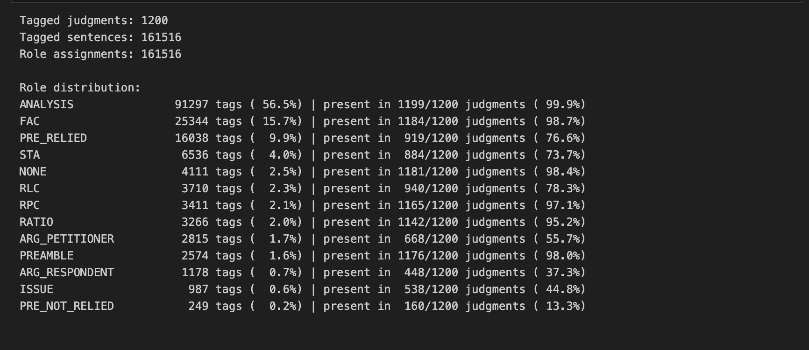
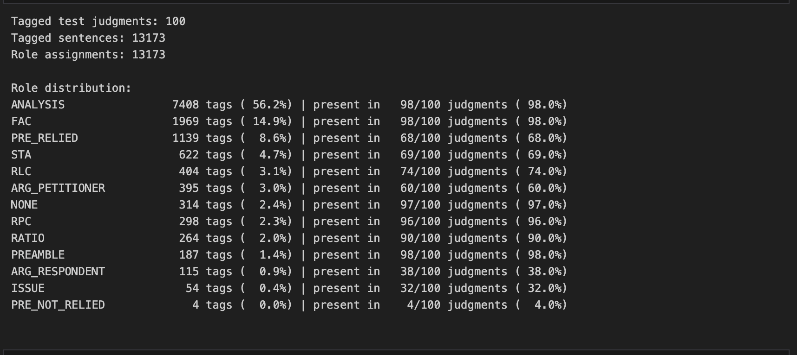

# Rhetorical Role Classification

This folder uses OpenNyAI's **pretrained rhetorical-role tagger** to add sentence-level role labels to IN-Abs judgments. It runs inference; it does not train or fine-tune the OpenNyAI model.

## Model architecture

```text
Judgment → sentence splitting → BERT encoder (self-attention)
         → contextual sequence labeling → rhetorical role per sentence
```

In this approach, BERT reads each sentence in context, and self-attention helps represent how its words relate. A sequence-labeling layer then uses the surrounding sentence context to predict a role such as **FACT**, **ISSUE**, **ARGUMENT**, **PREAMBLE**, or **RATIO**. OpenNyAI's published rhetorical-role baseline describes this as a BERT-based hierarchical sequence-labeling model (BERT-HSLN). These notebooks call OpenNyAI's pretrained `Rhetorical_Role` component; they do not train or fine-tune that model. See the [OpenNyAI repository](https://github.com/OpenNyAI/Opennyai) and its [rhetorical-role baseline](https://github.com/Legal-NLP-EkStep/rhetorical-role-baseline) for details.

The test notebook processes a separate test split. The role counts below describe generated labels, not accuracy or F1 evaluation results.

## Inputs and outputs

Put the prepared IN-Abs folder beside this README (or edit `DATA_ROOT` in each notebook):

```text
IN-Abs-prepared/
├── train/judgement/*.txt
└── test/judgement/*.txt
```

The training notebook tags up to 1,200 non-empty training judgments. The test notebook tags up to 100 non-empty test judgments. Each writes:

| Notebook | Output folder | Files |
| --- | --- | --- |
| `src/Rhetorical_tag_train_1200.ipynb` | `opennyai_train_1200/` | `tagged.jsonl`, `sentence_roles.csv` |
| `src/Rhetorical_tag_test_100.ipynb` | `opennyai_test_cpu_100/` | `tagged.jsonl`, `sentence_roles.csv` |

The JSONL contains one record per judgment, including its ID, source path, raw prediction, sentence roles, and tagged text. The CSV has one row per sentence with its document ID, sentence, and predicted role.

## Run locally

Use Python 3.13 or newer. In Terminal, from this folder:

```bash
python3.13 -m venv .venv-opennyai
source .venv-opennyai/bin/activate
python -m pip install --upgrade pip wheel
```

Install PyTorch for your operating system first, then install OpenNyAI and the remaining packages:

```bash
python -m pip install --no-deps opennyai==0.0.15
python -m pip install -r requirements-opennyai.txt
python -m ipykernel install --user --name legallens-opennyai --display-name "Python (LegalLens OpenNyAI)"
jupyter lab
```

Open the desired notebook, select **Python (LegalLens OpenNyAI)**, and run cells from top to bottom. The notebooks use CPU, so a GPU is not required. Internet access is needed the first time to download the pretrained model.

On Windows PowerShell, activate with the environment's `Scripts/Activate.ps1` script instead of the `source` command.

## Results

These screenshots summarize predicted role counts from the tagging runs. They are descriptive distributions, not classifier evaluation metrics.

**Training split — 1,200 judgments**



**Test split — 100 judgments**



The IN-Abs corpus and generated JSONL/CSV files are not included in this repository. Place the authorized dataset locally before running; tagged outputs contain judgment text.
